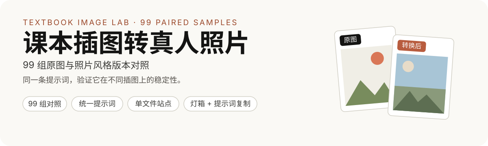
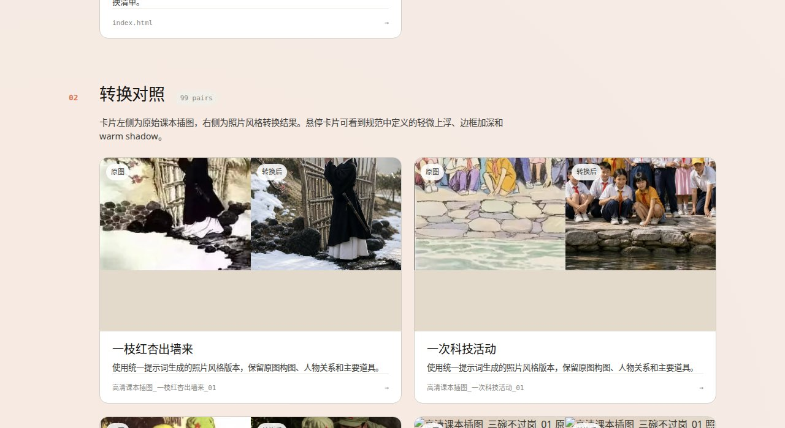

<p align="right"><a href="README.md">中文</a></p>

<p align="center">
  
</p>

<p align="center">
  <a href="https://text-book-pics.xiaosang.cc/">▶ Browse Online</a>
  ·
  <a href="https://github.com/holynova/text_book_pics">GitHub Repository</a>
  ·
  <a href="https://holynova.github.io/text_book_pics/">Backup Mirror</a>
</p>

Textbook Pics converts textbook illustrations into photo-realistic images: 99 original Chinese textbook illustrations shown side by side with Codex-generated photo-style versions. Every sample uses the same Chinese prompt — change only the illustrated texture into natural photographic realism, keeping composition, people count, poses, layout, clothing colors, key props, and mood. The point is to test one prompt's stability across different illustrations.

## Screenshots

<p align="center">
  
</p>

<p align="center">
  
</p>

## Contents

- **99 pairs**: one original textbook illustration (JPG) + one photo-style conversion (PNG) per pair — classic Chinese textbook scenes like 《一枝红杏出墙来》 (*A Sprig of Red Apricot*), 《一次科技活动》 (*A Science Activity*), 《七根火柴》 (*Seven Matches*), 《三碗不过岗》 (*Three Bowls, No Crossing the Ridge*), 《两只小狮子》 (*Two Little Lions*).
- **110 originals**: `origin/` holds 110 textbook illustrations; 99 converted so far, 11 pending (including 《蜜蜂引路》 *Bees Guide the Way*, 《雨后》 *After the Rain*, 《风筝》 *The Kite*, 《骆驼队》 *Camel Caravan*, 《黛玉初入贾府》 *Daiyu Enters the Jia Mansion*).
- **Source of originals**: a collection of Xiaohongshu posts of textbook illustrations (113 notes, see `origin/download_log.json`).
- **One shared prompt**: in Chinese and English, both copyable on the page — change texture, not content; no added people or objects, no text, watermarks, or effects; no cartoon/oil-painting/CG look, no deformed hands.

## Features

- **Side-by-side cards**: original on the left, converted version on the right; hovering lifts the card slightly and darkens its border.
- **Lightbox**: click to view large, original and conversion side by side, with prev/next navigation.
- **Copy the prompt**: one-tap copy for both the Chinese and English prompts.
- **Single-file site**: the whole site is one `index.html` (352 KB) — no framework, no build step, system fonts.

## Run Locally

```bash
python3 -m http.server 8000
# Open http://localhost:8000
```

## Tech

- Zero-dependency static single-file site: HTML + CSS + JS all in `index.html`; design language in `design_system.md` (rice white + terracotta + olive, serif headings + sans-serif body + monospace labels).
- Multi-tier image derivatives: 480/720px thumbnails + detail images, AVIF and JPG, 99 originals and 99 conversions each (1,188 derivative files in `assets/`).
- Original files are kept in `origin/` (110 JPGs) and `converted/` (99 PNGs).

```
index.html              Single-file site: 99 pair cards + lightbox + prompt copy
origin/                 110 original textbook illustrations (JPG) + download_log.json
converted/              99 photo-style conversions (PNG)
assets/thumbs-480/720/  Thumbnails (AVIF + JPG, 99 originals / 99 conversions each)
assets/detail-*/        Detail images (AVIF + JPG, 99 originals / 99 conversions each)
design_system.md        Design language document
```
