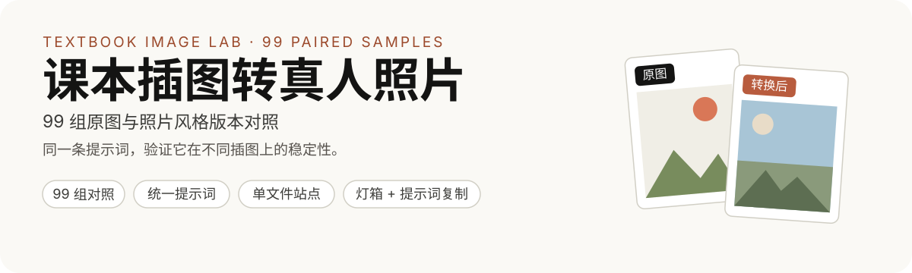
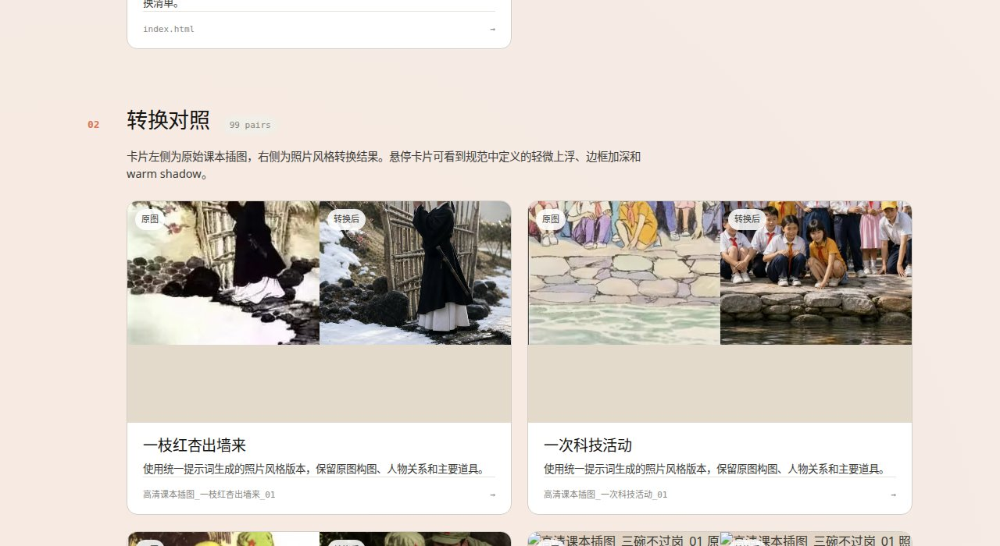

<p align="right"><a href="README.en.md">English</a></p>

<p align="center">
  
</p>

<p align="center">
  <a href="https://text-book-pics.xiaosang.cc/">▶ 在线浏览</a>
  ·
  <a href="https://github.com/holynova/text_book_pics">GitHub 仓库</a>
  ·
  <a href="https://holynova.github.io/text_book_pics/">备用镜像</a>
</p>

把课本插图转换成真实真人照片风格：99 张原始课本插图与 Codex 作图生成的照片风格版本并列对照。所有试样使用同一段中文提示词，只要求把绘画质感改成自然写实摄影质感，保留原图的构图、人物数量、人物姿势、场景布局、服装主色、主要道具和画面氛围——展示重点是同一条提示词在不同插图上的稳定性。

## 截图

<p align="center">
  
</p>

<p align="center">
  
</p>

## 内容

- **99 组对照**：每组一张原始课本插图（JPG）+ 一张照片风格转换图（PNG），如《一枝红杏出墙来》《一次科技活动》《七根火柴》《三碗不过岗》《两只小狮子》。
- **110 张原图**：`origin/` 共 110 张课本插图，其中 99 张已转换；另 11 张（《蜜蜂引路》《雨后》《风筝》《骆驼队》《黛玉初入贾府》等）暂未转换。
- **原图来源**：小红书课本插图帖子合集（113 篇笔记，见 `origin/download_log.json`）。
- **统一提示词**：中英双语，页内可一键复制；要点是只改质感不改内容，不新增人物或物体，不加文字、水印与特效，避免卡通感、油画感、CG 感与畸形手指。

## 功能

- **并列对照卡片**：左侧原图、右侧转换后，悬停卡片轻微上浮、边框加深。
- **灯箱**：点击看大图，原图与转换图并列，上一组 / 下一组切换。
- **提示词复制**：中英提示词各一键复制。
- **单文件站点**：整个站就是一个 `index.html`（352 KB），无框架、无构建，系统字体。

## 本地运行

```bash
python3 -m http.server 8000
# 打开 http://localhost:8000
```

## 技术

- 零依赖静态单文件站：HTML + CSS + JS 全在 `index.html`，设计语言见 `design_system.md`（米白 + 陶土 + 橄榄，衬线标题 + 无衬线正文 + 等宽标签）。
- 图片多级衍生：缩略图 480/720px + 详情图，AVIF 与 JPG 双格式，原图与转换图各 99 张（`assets/` 共 1,188 张衍生图）。
- 原图与转换图原文件保留在 `origin/`（110 张 JPG）与 `converted/`（99 张 PNG）。

```
index.html              单文件站：99 组对照卡片 + 灯箱 + 提示词复制
origin/                 110 张原始课本插图（JPG）+ download_log.json
converted/              99 张照片风格转换图（PNG）
assets/thumbs-480/720/  缩略图（AVIF + JPG，原图 / 转换图各 99 张）
assets/detail-*/        详情图（AVIF + JPG，原图 / 转换图各 99 张）
design_system.md        设计语言文档
```
